# Design: a calm, modern Campus Customs storefront

The previous site was glossy and busy: gradients, bevels, heavy shadows, animated scenery, a floating chat bubble, and a crowded nav bar. This redesign makes it feel like a refined collegiate storefront. The product is the hero, navigation is short but complete, and every page leads toward finding an item and buying it.

All five changes below were checked in the **running app** (React/Vite on :5173, FastAPI on :8000) with headless Chrome on Oct 7, 2026. Screenshots are in `output/app_check_images/design-*.png`. No browser console errors occurred during the walk-through.

| # | Change | Main files |
|---|---|---|
| 1 | Calmer look: flat surfaces, white space, serif + sans, navy / off-white / one accent | `frontend/src/index.css` (rewritten), `index.html` (fonts) |
| 2 | Slim sticky header with live-suggest search, account / My size / assistant icons, one "Shop" dropdown | `components/Header.tsx`, `catalog.ts`, `components/Icon.tsx` |
| 3 | Cleaner product tiles with hover size buttons; product page with a sticky purchase panel and "You might also like" | `components/ProductCard.tsx`, `pages/ProductDetail.tsx`, `pages/Bag.tsx`, bag state, backend `GET /api/products/{id}/similar` |
| 4 | Curated homepage: featured product, then Game Day, Residential Colleges, Gifts, New This Season | `pages/Home.tsx`, `catalog.ts` |
| 5 | Concierge assistant: a slim side panel instead of a floating bubble; suggested questions; compact product rows; short fades | `components/ChatWidget.tsx`, `components/ResultsShelf.tsx` |

---

## 1. Calmer look

### What changed
- **Flat surfaces:** every gradient, bevel, glossy highlight, "orb" icon, and animated sky/bubble background was removed. Surfaces are now flat white or paper, separated by **1px hairline borders** and generous spacing. The only shadows are a soft one under dropdowns and the side panel, so they read as layers above the page. *Verified: 0 elements on the home page use a gradient background (excluding loading placeholders).*
- **Type:** headings use **Fraunces**, a modern serif (display 36–58px, section titles 28px). Body and UI text use **Inter**, a clean sans at 15px. *Verified: both fonts load; computed `h1` font is Fraunces and `body` font is Inter.*
- **Color:** a three-part palette defined once as CSS variables.
  - **Yale navy** `#0f2a4a`: brand, headings, primary buttons, active states.
  - **Warm off-white** `#faf7f2`: page background, with white for cards and photos.
  - **One accent, brass** `#a3742b`: small eyebrow labels, low-stock notes, and the "My size" chip.
  - Everything else is neutral gray. *Verified: body background `rgb(250,247,242)`, heading and primary button `rgb(15,42,74)`, eyebrow `rgb(163,116,43)`.*
- **Product photography:** photos sit on white grounds with a hairline frame, so they read like a catalogue. The backend's photo cleanup was improved to remove leftover pockets of the old black background between sleeves and body, which the white grounds made visible.

### Why it helps customers stick around and buy
A quiet, consistent interface reads as premium and trustworthy, the way a well-run campus store feels. With fewer competing effects, the eye goes to the merchandise, price, and button. The serif and navy give a collegiate identity without decoration. One accent color means anything brass (like "Only 2 left in XL") actually gets noticed.

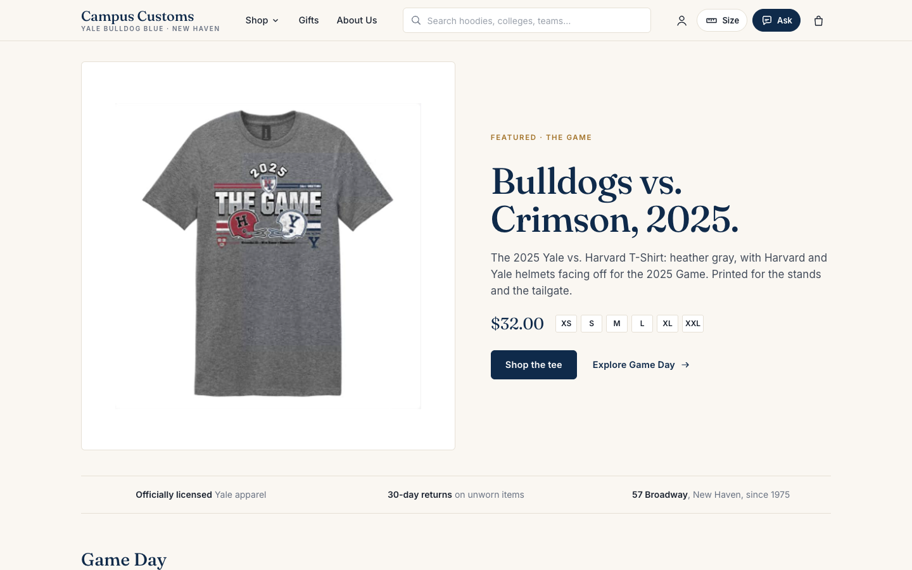

---

## 2. Slim navigation

### What changed
- **One thin sticky header** (65px, sticky on scroll) replaces the tall glossy toolbar. From left to right:
  - the **Campus Customs** wordmark (serif) with "Yale Bulldog Blue · New Haven"
  - three links only: **Shop ▾ · Gifts · About Us**
  - a **search box**
  - four controls: **Account** icon, **My size** chip, **Ask** (assistant) button, and **Bag** icon with an item count
- **One clean "Shop" dropdown** opens on hover or click and closes on outside click, Esc, or choosing a link. It has four tidy columns, all generated from real catalogue data, so every link has products:
  - **Clothing** (6 categories + All products)
  - **Collections** (Game Day, Residential Colleges, Gifts, New This Season)
  - **Residential Colleges** (the 11 colleges that have merchandise)
  - **Teams** (16 sports)
- **Live-suggest search:**
  - As you type (2+ characters), up to 6 matching products appear with thumbnail, category, and price. Arrow keys and Enter work.
  - A **"See all N results"** link opens the Products page filtered by the query (`/products?q=`).
  - It searches names, descriptions, tags, colors, and categories, so "hockey", "Davenport", or "navy" all work.
- **Account** opens a small menu: Log in / Create account, or "Hi, {name}" + Log out.
- **My size** opens the size picker and shows the chosen size ("L").
- **Ask** opens the assistant panel. **Bag** goes to the bag.
- **Nothing important is buried:**
  - Log in, Create account, and About are one click from every page.
  - The footer repeats Shop, Game Day, Residential Colleges, Gifts, About, Returns, Log in, and Create account.
  - On phones the header wraps into two rows, logo + icons and then links + full-width search, with no horizontal scrolling.

### Why it helps customers stick around and buy
Shoppers can reach any product in one or two clicks, or a few keystrokes, without scanning a cluttered menu. Live suggestions show real products and prices while you type, so a search turns into a product page immediately. The header stays visible while scrolling, so search, size, help, and the bag are always one tap away.

### Verified
| Check | Result |
|---|---|
| Header contents | Links: Shop, Gifts, About Us · Controls: Account, My size, Ask the Bulldog, Bag |
| Hover **Shop** | Dropdown with Clothing (7 links), Collections (4), Residential Colleges (11), Teams (16) |
| Type "hockey" | 5 live suggestions (Ice Hockey Left Chest Hoodie, Tri Blend Sports Hockey T-Shirt, Yale Sports Crewneck Field Hockey, Yale Sports Hoodie Hockey, Yale Sports T-Shirt Field Hockey) + "See all 5 results" |
| Press Enter | `/products?q=hockey`, heading "Results for 'hockey'", 5 styles |
| My size popover → pick L | Header chip changes to "L" |
| Mobile (390px) | Two-row header, no horizontal overflow |

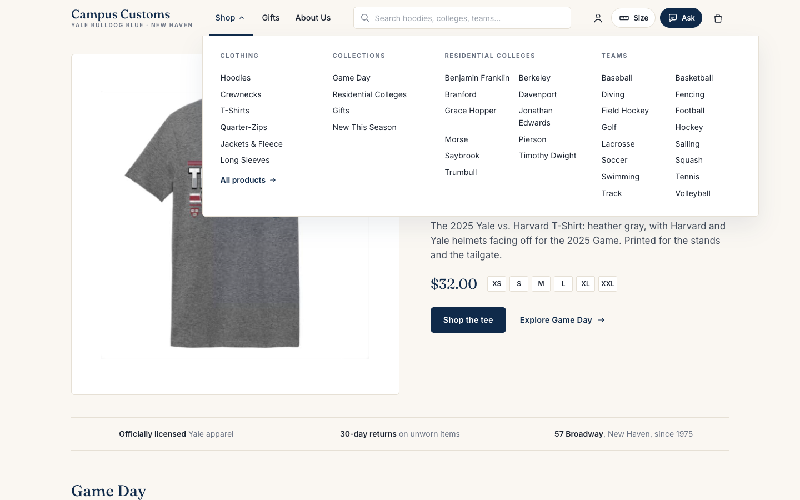
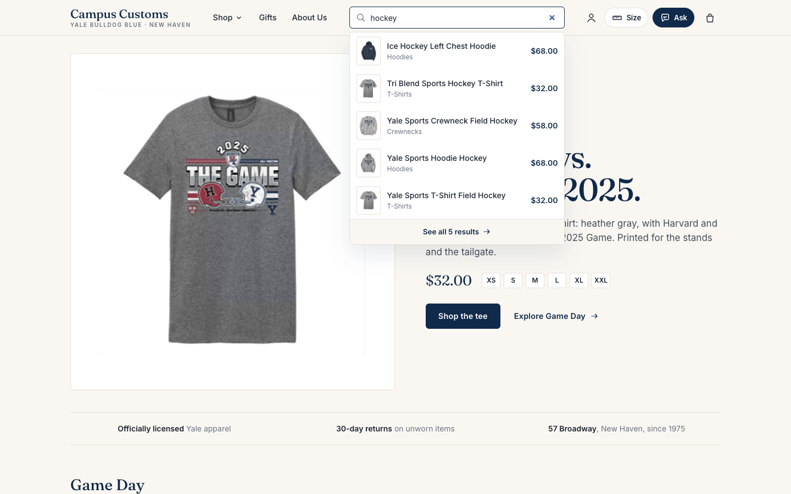
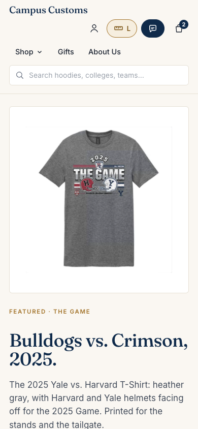

---

## 3. Cleaner product tiles, sticky purchase panel, "You might also like"

### What changed
**Product tiles** (one component everywhere: Products grid, collection rows, chat results):
- **Photo:** a uniform **4:5 photo** on white.
- **Text:** the **name**, a **one-line description** (kept so chat results still show a short description, as the chat contract requires), the **price**, and a small brass **low-stock note** such as "Only 2 left in XL" or "Sold out in L". With a size chosen, the note is about *your* size.
- **Hover size buttons:**
  - Hovering (or focusing) a tile reveals a row of **size buttons** over the bottom of the photo. Sold-out sizes are struck through and disabled.
  - Clicking a size adds that item to the **bag** in one step. An "Added to bag" confirmation appears under the bag icon and the count updates.
  - On touch screens the size row is always visible.
- **Bag page:**
  - Quantity steppers capped at the stock on hand, remove, and a subtotal.
  - **"Send order to the store"** opens a pre-filled email to orderdept@campuscustoms.com. Online payment isn't connected yet, and the page says so plainly.
- **Products page:**
  - A serif page title, breadcrumbs, and one quiet toolbar (category tabs, My size, sort) that stays visible while scrolling.
  - It reads `?category=`, `?collection=`, and `?q=`, so menu, search, and homepage links all land on the same tidy grid.

**Product page:**
- **Left:** a large photo, then a **Details** list: style, colors, item number, stock by size, and "Good for" tags.
- **Right: a sticky purchase panel** that stays in view (88px from the top) while you scroll the details. It contains:
  - category eyebrow, serif name, price, and the full description
  - color swatches
  - **size buttons**, starting on your size from My size
  - a live stock line: "Only 5 left in M" or "Size L is sold out right now. In stock in XS, S and XXL."
  - a quantity stepper and **"Add to bag · $68.00"**
  - **"Ask about this item"**, which opens the assistant with a question pre-filled
  - short reassurances: 30-day returns, pickup at 57 Broadway, contact email
- **"You might also like":** four similar styles underneath.
  - They come from a new endpoint, **`GET /api/products/{id}/similar?size=`**, which reuses the agent's alternatives ranking: same sport/school/mascot, category, color, and price.
  - It prefers items **in stock in your size**. Example: the sold-out-in-M Ice Hockey hoodie suggests the Yale Sports Hoodie Hockey first.

### Why it helps customers stick around and buy
- **Easy comparison:** uniform tiles with only name, price, and a stock cue are easy to scan.
- **Honest urgency:** low-stock notes nudge decisions without pressure.
- **Less friction:** hover size buttons cut a three-step add (open → choose size → add) to one click.
- **Ready to buy anywhere:** the sticky panel keeps the price and the **Add to bag** button in reach while the shopper reads the details, so there's never a moment where buying means scrolling back up.
- **No dead ends:** "You might also like" turns a sold-out size or a near-miss into another option, keeping the shopper browsing instead of leaving.

### Verified
| Check | Result |
|---|---|
| Tile photo ratio | 1.25 (4:5) on all 25 hoodie tiles |
| Low-stock notes | "Only 5 left in M", "Only 2 left in XXL", "Only 5 left in XS", "Only 2 left in XL" |
| Size row before / after hover | opacity 0 → 1; buttons XS (sold out, disabled), S, M, L, XL, XXL |
| Click a size on the tile | "Added to bag · Yale Sports Hoodie Hockey · S · View bag"; bag badge shows 1 |
| Product page (Ice Hockey Left Chest Hoodie) | Panel `position: sticky`; button "Add to bag · $68.00" |
| Scroll 150px / 300px | Panel stays at 88px from the top while the photo scrolls away |
| You might also like | Yale Sports Hoodie Hockey, Yale Mom Hoodie, Yale Dad Hoodie, Squash Left Chest Hoodie |
| Bag page | 2 items, subtotal $136.00 |

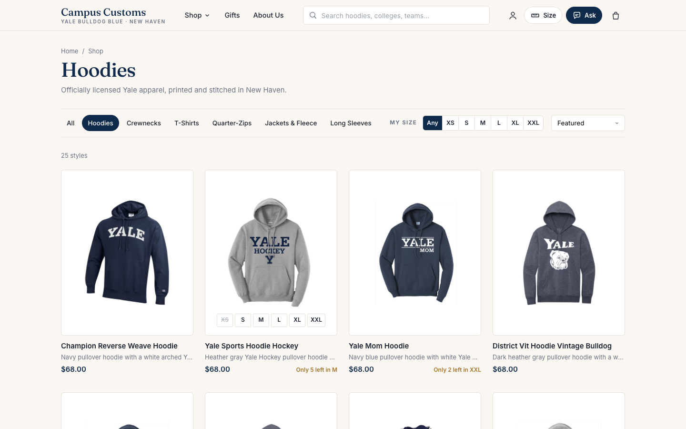
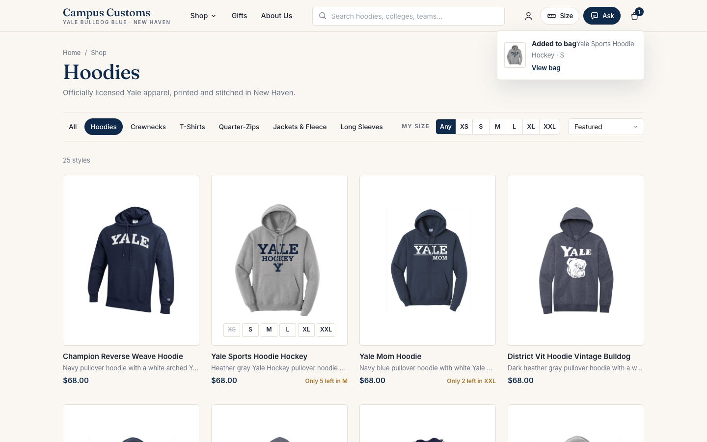
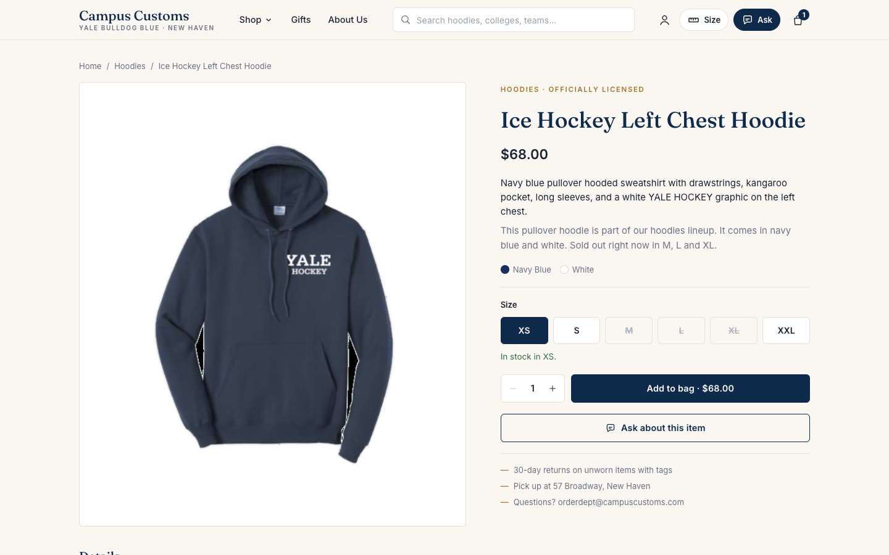
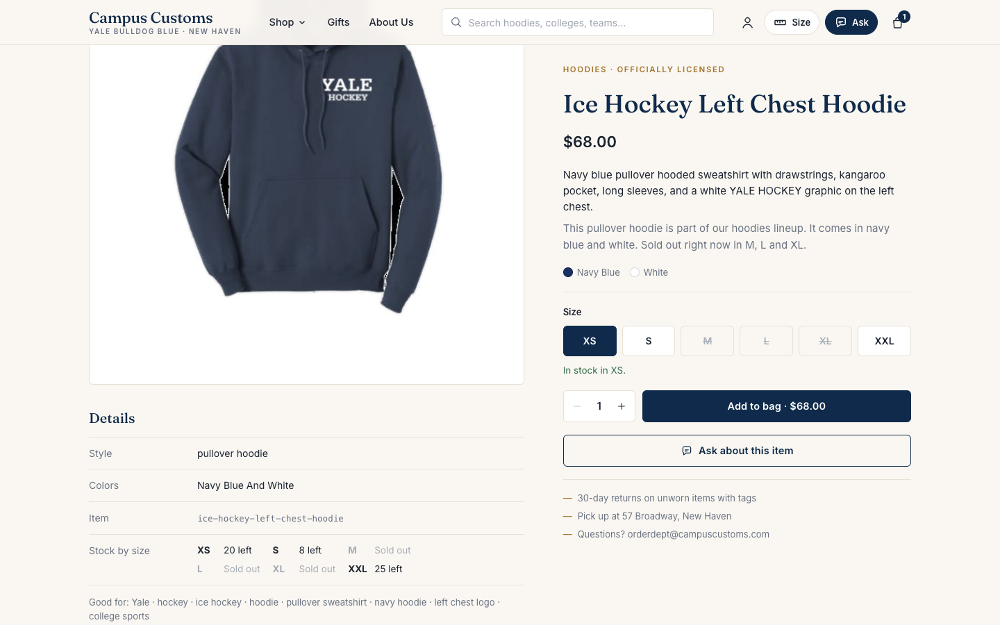
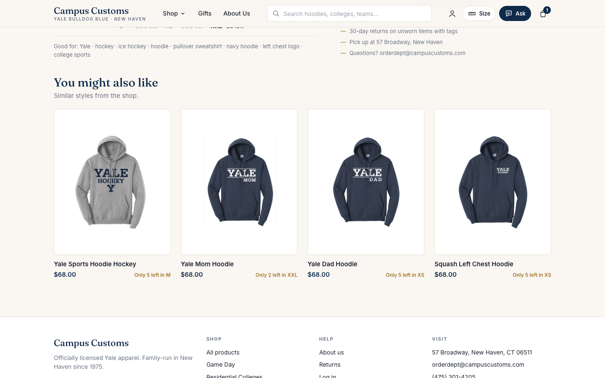
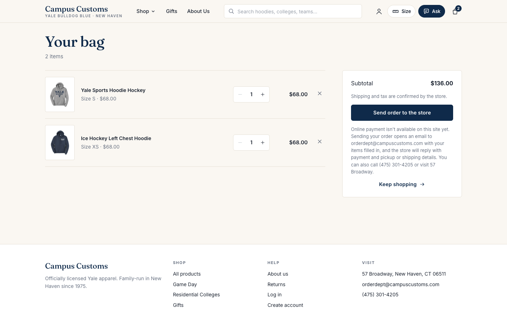

---

## 4. Curated homepage

### What changed
The homepage now opens with **one featured product**:
- the **2025 Yale vs. Harvard T-Shirt** (The Game), in a split layout: large photo on the left
- on the right: a brass "Featured · The Game" eyebrow, the serif headline **"Bulldogs vs. Crimson, 2025."**, a short description, the price, size availability, and two actions (**Shop the tee**, **Explore Game Day →**)

Below it:
- **A quiet trust strip:** officially licensed · 30-day returns · 57 Broadway since 1975.
- **Four collection rows,** each with a serif title, a one-line blurb, a "Shop all N" link, and a scrollable row of tiles:
  - **Game Day**: The Game tee plus varsity-team tees, crewnecks, and hoodies (32 styles)
  - **Residential Colleges**: crests for the colleges with merchandise (19)
  - **Gifts**: Yale Mom, Dad, Grandma, Grandpa, Aunt, Uncle, Brother, and Cousin pieces (12)
  - **New This Season**: fall layers, i.e., quarter-zips, fleece, and jackets (21). The catalogue has no arrival dates, so this row is a curated seasonal edit rather than a date filter.
- **Shop by category:** six image tiles.
- **A short invitation to ask the assistant** ("Not sure what to get?").

### Why it helps customers stick around and buy
- **Clear first impression:** a single featured product gives the page one strong message and one action, instead of competing banners.
- **Ways to browse:** collection rows give shoppers with a reason (game day, a college, a gift) a ready-made path, which lifts browsing time and gift purchases.
- **Trust:** the trust strip answers "is this official, and can I return it?" before it becomes a reason to hesitate.

### Verified
| Check | Result |
|---|---|
| First section | Featured product: "Featured · The Game" / "Bulldogs vs. Crimson, 2025." with price, sizes, two actions |
| Section order | Game Day → Residential Colleges → Gifts → New This Season → Shop by category |
| Rows | 8 tiles per row; "Shop all" links go to `/products?collection=…` |

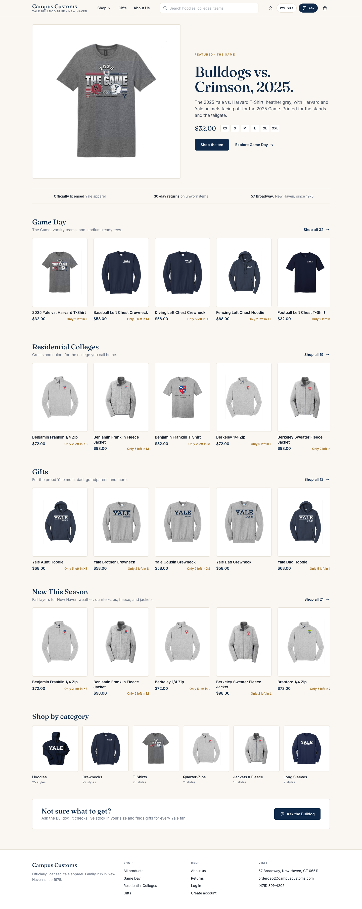

---

## 5. Concierge assistant

### What changed
- **No more floating bubble** (removed). The assistant now opens from the **Ask** button in the header, and from "Ask about this item" on product pages.
- **A slim right-hand panel** (420px, full height) slides in with a **200ms fade**, over a light scrim that closes it when clicked. It has:
  - a serif title **"Ask the Bulldog"** with the subtitle "Shopping concierge · checks live stock (in L)"
  - quiet message styling: assistant text on the page, shopper messages in navy bubbles
  - a composer at the bottom
- **Suggested questions** change with the page:
  - on a product page: "What sizes is this in stock in?", "What else goes with this?", "Do you have this in another color?"
  - on a category page: "Which hoodies are in stock in M?", "Any hoodies under $60?"
  - on the home page: "What hoodies do you have?", "Gifts for a Yale parent", "Anything for Davenport College?"
- **Compact product rows:** products in a reply appear as a tidy list inside the panel (thumbnail, name, in-stock sizes, price), each linking to its product page. The same results also appear on the page in a flat "From your conversation" section.
- **Short fades instead of bouncy animation:**
  - Every animation (panel, dropdowns, messages, tiles, page changes) is now a 180–220ms opacity fade or a small slide.
  - The earlier floating, bouncing, and pulsing effects are gone.
  - Everything turns off under `prefers-reduced-motion`.
- **Still there from Problem 9:** live progress steps ("How I found this"), the safety-check and message-limit notices, and the "Asking about…" context line, all restyled to match.

### Why it helps customers stick around and buy
- **Feels like service:** a side panel reads as a personal shopping concierge rather than a pop-up widget. The page stays visible and usable beside it, so shoppers can keep browsing while they ask.
- **Easy to start:** suggested questions remove the blank-box problem and show what the assistant is good at, like stock in your size and pairing ideas.
- **Easy to act on:** compact rows make its picks one click from a product page.
- **Calm:** short fades keep the site feeling fast and polished instead of distracting.

### Verified
| Check | Result |
|---|---|
| Floating chat bubble present? | No |
| Click **Ask** on the Davenport College Crewneck page | Panel open, 420px wide, flush right, full height; transition "opacity 0.2s, transform 0.2s" |
| Suggested questions there | "What sizes is this in stock in?", "What else goes with this?", "Do you have this in another color?" + "Asking about Davenport College Crewneck" |
| Tap "What else goes with this?" | Reply with compact rows: Davenport College Crewneck, Basic Hoodie Big Yale; "How I found this · 5 steps"; page section "Yale pieces to pair with it" |
| Prompt-injection message (regression) | "Safety check" notice still shown in the new panel |

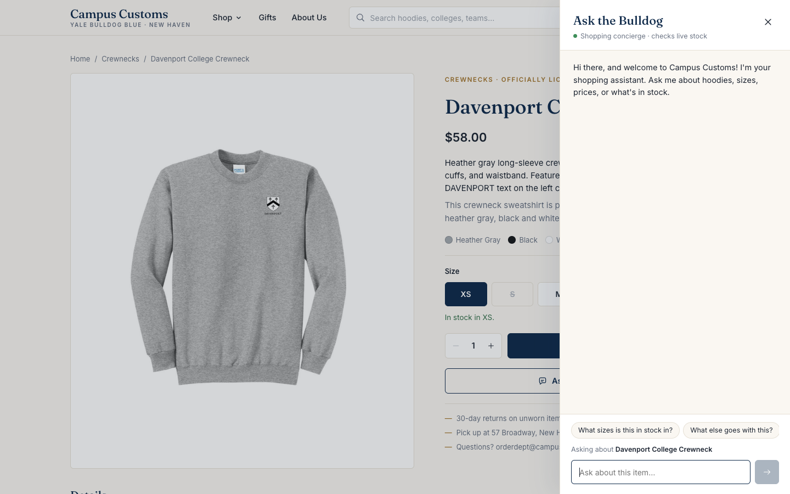
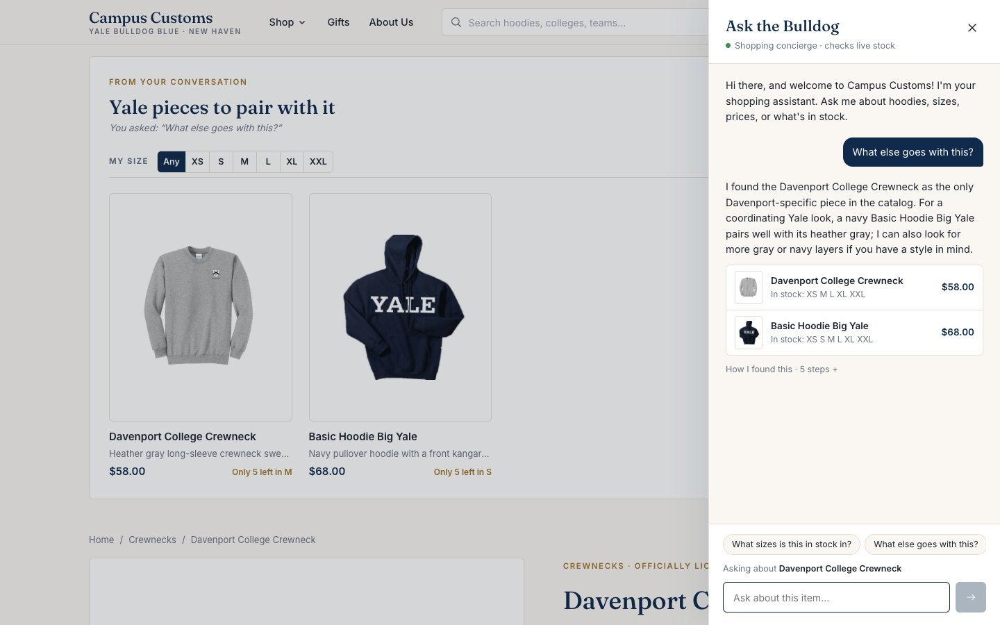
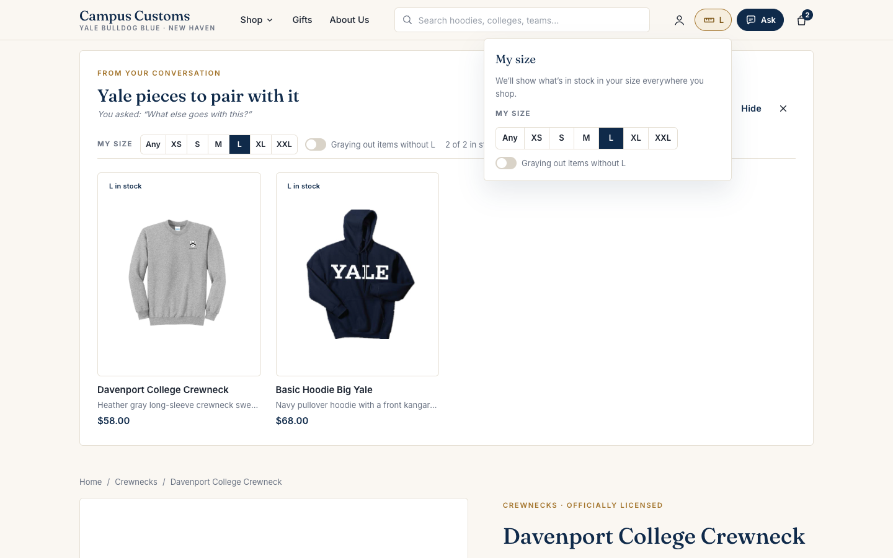
